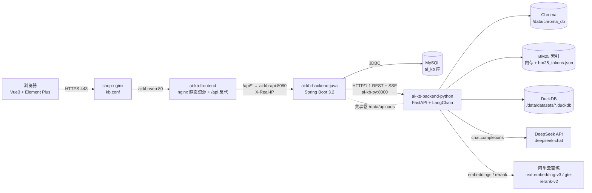
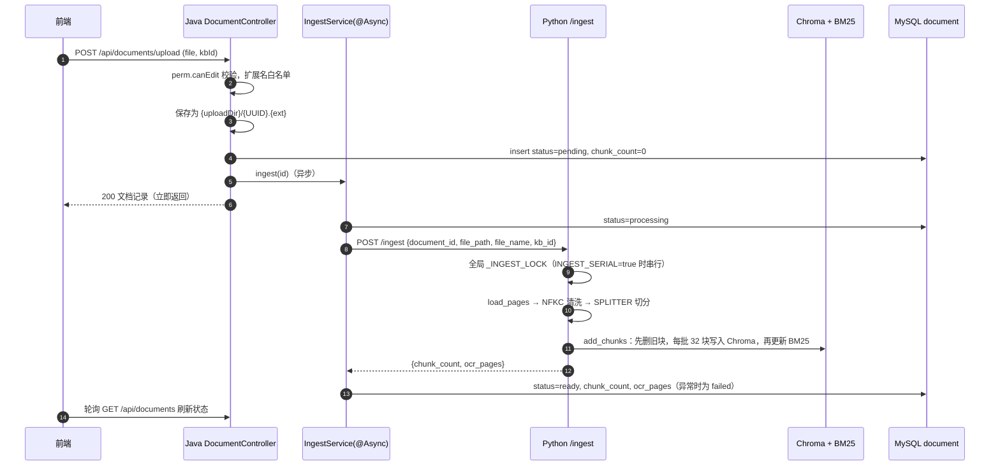
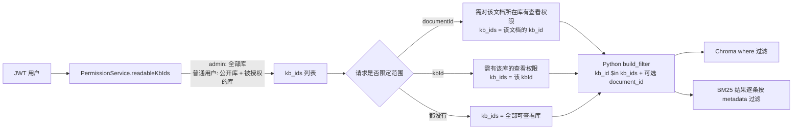
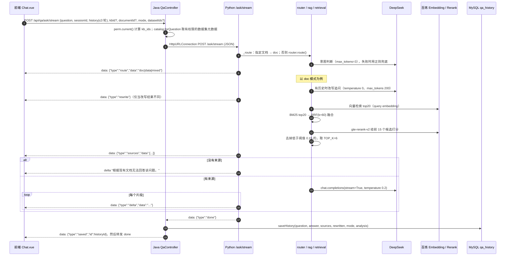
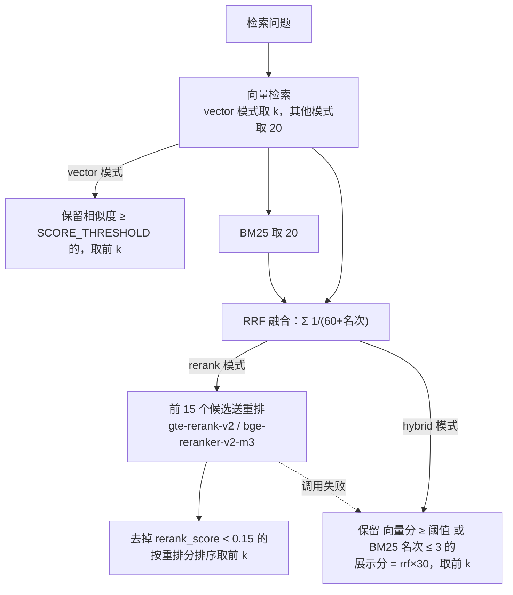
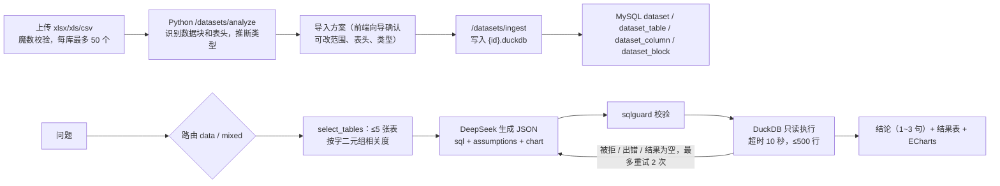
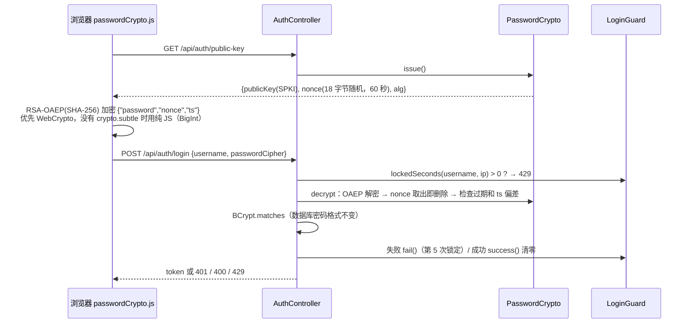
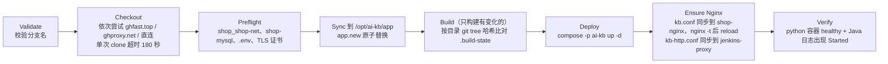

# 企业 AI 知识库 · 技术实现文档

> 依据：GitHub `yangjingquan/Enterprise_Knowledge_Base` main 分支最新提交 `5788584`（包含 `67a4bdb` 密码加密登录及其后的提交；67a4bdb 之后只改了 demo-data 和新增 `docker-compose.yml.bak-502`，没有改代码）。
> 文中的参数、阈值、提示词、超时都摘自代码或配置，括号里标出处。"默认值"指代码里的缺省值，实际运行值以环境变量为准；生产环境的取值见 `docker-compose.prod.yml`。

---

## 1. 概述与总体架构

### 1.1 系统定位

本系统是面向企业内部的知识问答平台，主要能力：

- **文档问答（RAG）**：支持 PDF、Word、Excel、PPT、TXT、Markdown 和网页。检索采用向量 + BM25 混合召回，再做重排；回答流式输出，并标注引用出处；支持多轮追问。
- **数据集问数**：上传 Excel 或 CSV 后，由大模型把中文问题转成 SQL，在 DuckDB 中只读执行，返回结论、结果表和图表。
- **混合问答**：先查制度文档拿到标准，再用数据分析判断"是否达标"。
- **知识库权限**：按知识库划分可见范围，成员角色分 viewer 和 editor。
- **效果评测**：60 道评测题，对比三种检索模式。

### 1.2 技术栈

| 层 | 技术 | 版本 / 出处 |
|---|---|---|
| 前端 | Vue 3 + Element Plus + vue-router + axios + ECharts + pdfjs-dist + marked/highlight.js | `frontend/package.json`（vue ^3.4、element-plus ^2.7、echarts ^5.6、pdfjs-dist 4.10.38、vite ^5.2） |
| 前端容器 | nginx:alpine，托管静态文件并反向代理 `/api/` | `frontend/Dockerfile`、`frontend/nginx.conf` |
| 业务后端 | Spring Boot 3.2.5、Java 17、Spring Security、MyBatis-Plus、jjwt | `backend-java/pom.xml`、`backend-java/Dockerfile` |
| AI 服务 | Python 3.11、FastAPI 0.143、LangChain 1.4.5、langchain-chroma 1.1.0、chromadb 1.5.9、openai SDK 3.29 | `backend-python/requirements.txt`、`backend-python/Dockerfile` |
| 向量库 | Chroma（本地持久化，余弦距离） | `app/vectorstore.py` |
| 关键词索引 | rank-bm25 0.2.2 + jieba 0.42.1 | `app/bm25.py` |
| 关系库 | MySQL 8.0（开发 compose 自带；生产复用 shop-mysql 的 `ai_kb` 库） | `docker-compose*.yml`、`sql/init.sql` |
| 分析库 | DuckDB 1.5.6（每个数据集一个 `.duckdb` 文件）+ sqlglot 30.23 | `app/datasets/store.py`、`sqlguard.py` |
| 大模型 | DeepSeek `deepseek-chat`（OpenAI 兼容接口，`https://api.deepseek.com`） | `app/rag.py` |
| 向量 / 重排 | 阿里云百炼 `text-embedding-v3`（1024 维）和 `gte-rerank-v2`；可切换为本地 `BAAI/bge-m3` 和 `BAAI/bge-reranker-v2-m3` | `app/embeddings.py`、`app/reranker.py` |
| OCR | RapidOCR（rapidocr-onnxruntime 1.4.4） | `app/document_loader.py` |

### 1.3 总体架构图



### 1.4 部署形态

| 项 | 开发 / 本地：`docker-compose.yml` | 生产：`docker-compose.prod.yml`（项目名 `ai-kb`） |
|---|---|---|
| MySQL | 自带 `mysql:8.0`，端口 3307→3306；buffer pool 128M、关闭 performance_schema、max-connections 50；`mem_limit` 512m | 不包含 MySQL，复用服务器上的 `shop-mysql`，库名 `ai_kb` |
| backend-python | `mem_limit ${PY_MEM_LIMIT:-1g}`；构建参数 `WITH_LOCAL_MODELS=false` | `mem_limit 1g`，`memswap_limit 1280m`；`--workers 1`；DuckDB 内存 256MB、2 线程；OCR_DPI 150、OCR_MAX_SIDE 1600；`INGEST_SERIAL=true` |
| backend-java | `mem_limit 512m`；JVM `-Xms128m -Xmx256m -XX:MaxMetaspaceSize=128m -XX:+UseSerialGC -Xss512k` | `mem_limit 384m`，`memswap_limit 512m`；JVM `-Xms64m -Xmx256m … -XX:ReservedCodeCacheSize=48m` |
| frontend | `mem_limit 64m`，端口 5173→80 | `mem_limit 64m`，不映射宿主机端口 |
| 网络 | default 网络；backend-java 别名 `ai-kb-api` | 外部网络 `shop_shop-net`；别名分别为 `ai-kb-py`、`ai-kb-api`、`ai-kb-web` |
| 数据卷 | `./chroma_db`、`./uploads`、`./datasets_data`、`mysql_data`、`hf_cache` | `ai-kb-chroma`、`ai-kb-uploads`、`ai-kb-datasets` |
| 机密 | `.env`（模板见 `.env.example`） | `env_file: /opt/ai-kb/.env`（文件注释要求 chmod 600，不进 Git） |

持续部署使用 Jenkins 任务（`deploy/Jenkinsfile`），流程见第 9 节。

---

## 2. 模块职责与接口

### 2.1 Java 与 Python 的分工

| 职责 | Java（`backend-java`） | Python（`backend-python`） |
|---|---|---|
| 认证鉴权 | JWT 签发与校验、RSA 登录、登录限流（`AuthController`、`SecurityConfig`、`PasswordCrypto`、`LoginGuard`） | 不参与鉴权（只在内网被 Java 调用） |
| 权限计算 | `PermissionService` 算出"可查看的知识库 ID 列表"，随请求传给 Python | 检索时按 `kb_ids` 过滤 |
| 业务数据 | 用户、知识库、成员、文档记录、问答历史、数据集元数据（MySQL） | — |
| 文件 | 上传保存（UUID 重命名）、原文下载（校验路径在上传目录内）、删除 | 网页下载保存、解析 |
| AI | 转发问答请求、代理 SSE 并保存历史 | 解析切分、向量化、混合检索、重排、调用大模型、意图路由、NL2SQL、DuckDB |

Java 调用 Python 用的是 `RestClient` + `SimpleClientHttpRequestFactory`。代码注释说明用 HTTP/1.1 是为了避免 JDK HttpClient 发起 h2c 升级，而 uvicorn 不支持。代码没有显式设置连接或读取超时（`IngestService`、`QaController` 构造器）。流式问答单独用 `HttpURLConnection` 读取 Python 的 SSE。

### 2.2 Java 对外接口（前端调用，前缀 `/api`）

| 模块 | 方法与路径 | 说明 |
|---|---|---|
| 认证 | `GET /auth/public-key` | 返回 RSA 公钥（SPKI base64）和一次性 nonce，`expiresIn=60`，`alg=RSA-OAEP-256` |
| | `POST /auth/login` | `{username, passwordCipher}`，成功返回 `token, username, displayName, role` |
| 知识库 | `GET /kbs`；`GET/POST /admin/kbs`；`PUT/DELETE /admin/kbs/{id}`；`GET/PUT /admin/kbs/{id}/members` | 库里还有文档时不允许删除（`KbController.delete`） |
| 文档 | `POST /documents/upload`（multipart `file`, `kbId`）；`POST /documents/url`；`GET /documents`；`PUT /documents/{id}/kb`；`GET /documents/{id}/file`；`GET /documents/{id}/context`；`DELETE /documents/{id}` | `DocumentController` |
| 问答 | `POST /qa/ask`；`POST /qa/ask/stream`（SSE）；`POST /qa/{id}/feedback`；`GET /qa/history`；`GET /qa/feedback/stats`；`GET /qa/{id}/export.csv` | `QaController` |
| 数据集 | `POST /datasets/upload`；`GET /datasets`；`GET /datasets/{id}`；`GET /datasets/{id}/plan`；`GET /datasets/{id}/sheets/{sheet}/grid`；`POST /datasets/{id}/plan/block`；`PUT /datasets/{id}/plan`；`GET /datasets/{id}/preview`；`PUT /datasets/{id}/columns`；`DELETE /datasets/{id}`；`GET /datasets/types` | `DatasetController` |
| 用户 | `GET/POST /admin/users`；`PUT /admin/users/{id}` | 密码只接受 `passwordCipher` |
| 评测 | `POST /admin/eval/run`；`GET /admin/eval/status` | 转发到 Python 的 `/eval/*` |

### 2.3 Python 内部接口（只供 Java 调用，`app/main.py`、`app/datasets/api.py`）

| 路径 | 作用 |
|---|---|
| `POST /ingest` | 解析 → 切分 → 向量化 → 写入 Chroma 和 BM25，返回 `chunk_count`、`ocr_pages` |
| `POST /parse` | 只解析切分，返回块数和前 3 块预览（调试用） |
| `POST /kb-sync` | 批量修改文档块的 `kb_id` 元数据，不重新向量化 |
| `DELETE /documents/{id}` | 删除该文档的全部向量和 BM25 条目 |
| `POST /fetch-url` | 下载网页并保存为 HTML |
| `GET /documents/{id}/context` | 取某块及前后各 `window` 块（`window` 上限 5） |
| `POST /ask`、`POST /ask/stream` | 问答（一次性返回 / SSE），按路由分到 doc、data、mixed |
| `GET /search` | 检索调试，可指定 `mode` |
| `POST /eval/run`、`GET /eval/status` | 后台评测和报告 |
| `GET /stats` | 索引规模和检索配置 |
| `POST /admin/reindex`、`GET /admin/reindex` | 用当前向量模型重建索引 |
| `/datasets/analyze`、`/{id}/plan`、`/{id}/grid`、`/{id}/block`、`/ingest`、`/{id}/preview`、`DELETE /{id}`、`/query` | 数据集相关 |
| `GET /health` | 健康检查（compose healthcheck 使用） |

---

## 3. 文档解析与切分

实现集中在 `backend-python/app/document_loader.py`，入口是 `split_document(path, document_id, file_name)`，它先调用 `load_pages(path)` 得到 `[(页码, 文本, 额外元数据)]`，再切分。

### 3.1 支持的格式与解析器

格式白名单在 Java 端：`DocumentController.ALLOWED = {pdf, docx, xlsx, pptx, txt, md}`；网页通过 `/documents/url` 导入，`file_type=url`，保存为 `.html`。

| 格式 | 解析器 | "页"的含义 | 处理细节 | 额外元数据 |
|---|---|---|---|---|
| PDF | `pdfplumber` | PDF 页（从 1 开始） | 每页 `page.extract_text()` 得到正文，`page.extract_tables()` 得到表格，表格经 `_table_to_md` 转成 Markdown 后拼在正文后面；扫描页走 OCR（见 3.2） | `ocr: True`（OCR 页） |
| DOCX | `python-docx` | 全文统一记为第 1 页（代码注释：Word 没有可靠页码） | 非空段落 + 全部表格（转 Markdown），用换行拼接 | — |
| XLSX | `openpyxl`（`data_only=True, read_only=True`） | 工作表序号 | 见 3.3 | `sheet_name` |
| PPTX | `python-pptx` | 幻灯片序号 | 首行写"幻灯片{i}：{标题}"；递归提取文本框、表格（转 Markdown）和组合形状（`shape_type == 6`）；演讲者备注加"备注："前缀 | `slide_title` |
| HTML（网页） | `trafilatura.extract(include_tables=True, include_comments=False, favor_recall=True)` | 1 | 去掉导航、广告，只保留正文和表格 | — |
| TXT / MD | 直接读取（UTF-8，`errors="ignore"`） | 1 | — | — |

不支持的扩展名会抛 `ValueError("不支持的文件类型")`。注意：`.doc`、`.xls`、`.ppt` 这类老格式不在文档白名单内；`.xls` 只在"数据集"功能中支持。

### 3.2 扫描件 OCR

以下参数可通过环境变量设置：

| 参数 | 默认值 | 生产值 | 含义 |
|---|---|---|---|
| `OCR_ENABLED` | true | true | 是否启用 |
| `OCR_MIN_CHARS` | 20 | 默认 | 一页提取到的文字少于该数，且页面上有图片（`page.images`）时，判定为扫描页 |
| `OCR_DPI` | 200 | 150 | 渲染分辨率 |
| `OCR_MAX_SIDE` | 2000 | 1600 | 渲染后图片最长边的像素上限，超过则 `thumbnail` 缩小 |

`_ocr_page` 的处理流程：

1. 页面渲染成 RGB 图片，交给 RapidOCR 识别。引擎通过 `@lru_cache` 懒加载，只在遇到扫描页时才加载。
2. 丢弃置信度低于 0.5 的文字框。
3. 按文字框中心的纵坐标排序；相邻框的纵向差小于半个字高时归为同一行。
4. 行内按横坐标排序、用空格连接，从而保留表格类扫描件"项目 标准 结果"的对应关系。

OCR 页只输出识别文本，不再提取表格。`/ingest` 会统计带 `ocr` 标记的页数作为 `ocr_pages` 返回，Java 写入 `document.ocr_pages`，前端据此显示"OCR"标签。

### 3.3 Excel 的特殊处理（`_load_xlsx`）

- 每个工作表作为一页。整行为空的行跳过。第一行作为表头，表头为空的列改名为"第N列"。
- 每一行数据转成"列名：值"的记录文本，例如 `备件编号：SP-SK-003；备件名称：…。`。代码注释给出的理由：Markdown 表格里大量字符是重复的表头和"|"，各块向量看起来几乎一样；记录文本语义更集中。
- 单元格转字符串时，整数形式的浮点数去掉 `.0`。
- 多行记录按顺序累加成一组，每组不超过 `XLSX_BLOCK_CHARS = 450` 个字符（比切分长度 500 略小，保证一组正好落在一个块里）。每组前加 `工作表：{名称}\n`，组之间用空行分隔。

### 3.4 文本清洗

`split_document` 对每页文本依次做两步：

1. `unicodedata.normalize("NFKC", text)`：把"⼀""⽇"这类康熙部首字符转成标准汉字。
2. `.translate(_RADICAL_MAP)`：NFKC 处理不了"CJK 部首补充"区（如"⻔""⻋"），这里用约 30 个字符的手工映射表转回标准汉字。

网页下载时还有编码处理，见 3.6。

### 3.5 切分策略

```python
SPLITTER = RecursiveCharacterTextSplitter(
    chunk_size=500, chunk_overlap=50, keep_separator="end",
    separators=["\n\n", "\n", "。", "！", "？", "；", " ", ""],
)
```

| 参数 | 值 | 说明（来自代码注释） |
|---|---|---|
| 切分器 | LangChain `RecursiveCharacterTextSplitter` | 按分隔符优先级递归切分 |
| `chunk_size` | 500 字符 | 太长检索不精准，太短上下文不完整 |
| `chunk_overlap` | 50 字符 | 避免一句话被切断后丢失语义 |
| `keep_separator` | `"end"` | 句号等分隔符留在上一块末尾 |
| `separators` | 段落 → 换行 → 。！？； → 空格 → 任意字符 | 中文句末标点优先于空格 |

- **按页切分**：先按"页"（PDF 页、工作表、幻灯片）分开，再在页内切，所以一个块不会跨页，页码可以精确引用。
- **标题和表格**：没有专门的标题层级识别。表格统一转成 Markdown 文本（PDF、DOCX、PPTX），和正文一起参与切分，因此大表格可能被切成多块。
- 去掉空白块。
- **每块元数据**：`document_id`、`file_name`、`page`、`chunk_index`（文档内全局递增），加上格式相关的 `sheet_name`、`slide_title`、`ocr`。写入时再加 `kb_id`（见 4.3）。

### 3.6 网页导入（`app/web_fetch.py`）

1. **校验**：只允许 `http`、`https`，netloc 不能为空。
2. **下载**：
   - 使用 `requests.get(stream=True)`，超时 `(5, 20)` 秒（连接、读取）。
   - 浏览器风格的 User-Agent。
   - 大小上限 `MAX_BYTES = 5MB`，超过立即中止。
   - Content-Type 必须包含 html 或 xml。
3. **解码**，按顺序尝试：响应头编码（忽略 ISO-8859-1）→ `<meta charset>` → `charset_normalizer` 猜测 → UTF-8。gb2312 和 gbk 统一按 gb18030 解码。
4. **预检**：先用 trafilatura 试提取一次正文，不到 20 字就报错"未能从网页中提取到正文"。
5. **标题**：依次取 trafilatura 识别的标题、`<title>`、域名，截断到 150 字。
6. **保存**：以 UTF-8 保存为 `{UPLOAD_DIR}/{uuid}.html`，返回 `title, file_path, url`。

Java 端还会校验网址长度不超过 1000，并把网页标题作为 `file_name`，所以引用来源显示的是网页标题。

### 3.7 上传与异步处理流程



- **状态机**：`pending → processing → ready / failed`（`IngestService.ingest`）。失败只记日志，`document` 表没有错误信息字段。
- **异步**：用 Spring 的 `@EnableAsync` 加 `@Async`，没有自定义线程池（代码里找不到 `TaskExecutor` 配置）。
- **串行化**：Python 有两层锁：
  - `main._INGEST_LOCK`：`INGEST_SERIAL` 默认 true，同一时刻只处理一个文件，防止多个 OCR 同时进行导致内存叠加；
  - `vectorstore._INGEST_LOCK`：向量化写入排队。
- **上传限制**：
  - Spring `max-file-size` 和 `max-request-size` 都是 50MB（`application.yml`）；超限由 `GlobalExceptionHandler` 返回 413 和中文提示；
  - nginx `client_max_body_size 60m`。

### 3.8 去重、删除与重建

- **去重**：没有内容去重。同一个文件上传两次会生成两条 `document` 记录，在向量库里也是两份。重复处理同一个 `document_id` 时，`add_chunks` 会先 `delete_document(document_id)` 再写入，所以同一文档不会重复入库。
- **删除**（`DELETE /api/documents/{id}`）：
  1. 需要编辑权限；
  2. 调 Python 删除向量和 BM25 条目（失败只记 warn）；
  3. 删除数据库记录；
  4. 确认路径在上传目录内后，删除原文件。
- **移动知识库**（`PUT /documents/{id}/kb`）：需要源库和目标库的编辑权限。Python 端只改 Chroma 元数据和 BM25 里的 `kb_id`，不重新向量化（`set_document_kb`）。
- **重试**：没有"重新解析失败文档"的接口，失败的文档只能删除后重新上传。
- **重建索引**：切换向量模型后使用，见 4.6。

---

## 4. 向量化与存储

### 4.1 向量模型（`app/embeddings.py`）

| 配置 | 默认值 | 说明 |
|---|---|---|
| `EMBEDDING_PROVIDER` | `dashscope` | 也可设为 `local` |
| `DASHSCOPE_BASE_URL` | `https://dashscope.aliyuncs.com/compatible-mode/v1` | OpenAI 兼容的 `/embeddings` 接口 |
| `DASHSCOPE_EMBEDDING_MODEL` | `text-embedding-v3` | 注释说明也支持 v4 |
| `EMBEDDING_DIM` | 1024 | 请求体字段 `dimensions` |
| `EMBEDDING_BATCH` | 10 | 每次请求最多 10 条 |
| `EMBEDDING_TIMEOUT` | 30 秒 | 单次请求超时 |
| `EMBEDDING_RETRIES` | 4 | 429 和 5xx、连接错误、超时会重试，退避 `min(2^n, 16) + 0~0.5` 秒；其他 4xx 直接报错 |
| `MAX_CHARS` | 8000 | 单条文本超长截断；空串替换为 `" "` |
| local 模式 | `BAAI/bge-m3` | `HuggingFaceEmbeddings(normalize_embeddings=True)`，需要构建时 `WITH_LOCAL_MODELS=true`；注释称约占 2.3GB 内存 |

**低内存配置**：默认 dashscope 模式不在本机加载模型。compose 注释记录的实测内存：Python 容器空闲约 130MB、问答约 300MB、OCR 峰值约 750MB，因此 `PY_MEM_LIMIT` 默认 1g。改用本地模型时，注释建议调到 6g 以上，`.env.example` 要求内存 ≥ 8GB。

### 4.2 Chroma 集合设计（`app/vectorstore.py`）

- **单集合存放全部文档**，用元数据区分文档和知识库。
- **集合名**（`embeddings.collection_name()`）：每种向量模型一个集合，防止不同维度、不同语义的向量混用。
  - dashscope：`kb_docs_dashscope_{模型简写}_{维度}`，默认是 `kb_docs_dashscope_v3_1024`；
  - local + bge-m3：沿用老集合 `kb_docs`；
  - 可用 `CHROMA_COLLECTION` 强制指定。
- **相似度**：`collection_metadata={"hnsw:space": "cosine"}`，`similarity = 1 - distance`。
- **持久化**：`persist_directory=CHROMA_DIR`。开发环境挂载 `./chroma_db`，生产挂载卷 `ai-kb-chroma` 到 `/data/chroma_db`。评测报告默认也写在该目录（`EVAL_REPORT`）。
- **块 ID**：`{document_id}_{chunk_index}`。
- **写入**：每批 `BATCH = 32` 个块调用 `add_documents`；dashscope 内部再按每 10 条一次请求。
- **元数据字段**：`document_id, file_name, page, chunk_index, kb_id`，可选 `sheet_name, slide_title, ocr`。

### 4.3 知识库隔离与权限过滤



- 每次写入都会给块的元数据写上 `kb_id`（为空时记 0）。
- `kb_ids=[]` 表示没有任何权限：向量检索和 BM25 都直接返回空（`vectorstore.search`、`bm25.search`、`retrieval.retrieve` 三处都判断）。
- 文档同步：Java 启动时 `KbSyncRunner`（`@Order(3)`）在后台线程中把所有 `status=ready` 文档的"文档→知识库"映射推给 Python 的 `/kb-sync`。失败时每 10 秒重试一次，最多 30 次。这一步用来给升级前没有 `kb_id` 的老块补齐数据，也能修复异常中断造成的不一致。

### 4.4 BM25 关键词索引（`app/bm25.py`）

- **为什么需要**：代码注释说明，向量检索对设备编号、故障代码、型号、金额这类精确字符串不敏感（如 E-03、LF-10、8200 小时），需要关键词检索补充。
- **分词 `tokenize`**：
  1. 先 NFKC 规范化并转小写；
  2. 用正则 `_CODE_RE` 提取编号类整体词，例如 `[a-z][a-z0-9]*(?:- ?[a-z0-9]+)+`，允许连字符后带一个空格，因为 PDF 表格里会把编号折行成"E- 03"；同时保留去掉连字符的形式（`lf-10` 和 `lf10`）；
  3. 用 `_NUM_RE` 提取数字（含小数）；
  4. 用 `jieba.cut_for_search` 切中文，过滤停用词（约 35 个虚词）和纯标点。
- **索引**：`BM25Okapi`，每次增删后全量 `_rebuild`，用 `threading.RLock` 保证线程安全。
- **持久化**：分词结果缓存到 `CHROMA_DIR/bm25_tokens.json`，先写临时文件再替换，防止写到一半崩溃导致文件损坏。
- **与 Chroma 的一致性**：
  - 启动时 `sync_from_chroma` 以 Chroma 为准全量对账：缓存里没有的块重新分词，Chroma 已删除的块从索引中去掉；
  - 写入、删除、修改 kb 时同步更新（`vectorstore.add_chunks / delete_document / set_document_kb`）。
- **检索**：按分数倒序，只返回分数 > 0 的块，`document_id` 和 `kb_ids` 在结果上逐条过滤。

### 4.5 MySQL 与向量库的对应关系

| MySQL `document` | 向量库 / BM25 |
|---|---|
| `id` | 元数据 `document_id`，块 ID 前缀 |
| `kb_id` | 元数据 `kb_id`（上传时写入，移动时用 `/kb-sync` 更新，启动时全量对账） |
| `chunk_count`、`ocr_pages`、`status` | 由 `/ingest` 的返回值回写 |
| `file_name` | 元数据 `file_name`（引用来源显示） |

两边没有分布式事务。删除向量失败时数据库记录照删（`IngestService.deleteVectors` 只记 warn），所以可能留下孤立向量；这类不一致目前没有自动清理（见第 10 节）。

### 4.6 切换模型后重建索引（`app/reindex.py`）

- 入口：`python -m app.reindex [--source 集合名] [--force]`，或 `POST /admin/reindex`（后台执行，`GET` 查看进度）。
- **源集合**：默认自动选择同一 Chroma 目录下块数最多的其他集合（`pick_source`）。
- **复制方式**：每次读取 200 块（`PAGE = 200`），块 ID、文本、元数据原样保留，只用当前模型重新计算向量后 `upsert`；目标集合里已有的块默认跳过，所以可以断点续跑。
- **收尾**：完成后重新对账 BM25。
- **启动提醒**：Python 启动时，如果当前集合为空但存在旧集合，日志会提示运行重建。

---

## 5. RAG 问答链路

### 5.1 端到端时序（流式）



Java 对每一行"原样转发并立即 flush"，同时拼接答案，并记录 sources、rewrite、route、sql/table/chart。收到 `done` 后先保存历史，插入一条 `saved` 事件，再转发 `done`；如果 Python 异常断开、没发 `done`，也会保存已生成的部分。响应头带 `X-Accel-Buffering: no` 和 `Cache-Control: no-cache`。生产的宿主 nginx（`deploy/nginx/kb.conf`）设置 `proxy_buffering off`、读写超时 300 秒；前端容器 nginx 同样关闭缓冲、超时 300 秒。Spring MVC 异步请求超时是 180000 ms（`application.yml`）。

前端用 `fetch` + `res.body.getReader()` + `TextDecoder` 按行解析 `data:` 事件。当前会话保存在 `sessionStorage`，切换页面再回来不会丢失。

### 5.2 意图路由（`app/datasets/router.py`、`main._route`）

1. 请求里带 `document_id` 时，直接走 `doc`。
2. 前端显式指定 `doc`、`data` 或 `mixed` 时，按指定的走。
3. `auto` 模式下，没有可用数据集就走 `doc`。有数据集时，把最多 30 张表（每表取名称和前 20 个列名）放进 `ROUTE_SYSTEM` 提示词，调用 DeepSeek（`temperature=0, max_tokens=3`）输出 `doc`、`data` 或 `mixed`。
4. 大模型调用失败或输出无法识别时，用正则兜底：
   - `_DATA_HINT`：统计、汇总、合计、占比、同比、排名、TopN、最高、最多、多少、"按…分组""各…的"等；
   - `_DOC_HINT`：制度、规定、标准、手册、流程、"是否符合/达标/超标"等；
   - 两类都命中走 `mixed`，只命中数据类走 `data`，否则走 `doc`。
5. 路由结果是 `data` 或 `mixed`、但没有数据集时，退回 `doc`。

### 5.3 多轮上下文与问题改写（`app/rag.py`）

- Java `cleanHistory`：只保留 question、answer 和可选的 sql（截断到 4000 字），最多 3 轮（`MAX_HISTORY_ROUNDS=3`）。
- Python `normalize_history`：再取最近 3 轮，历史答案截断到 600 字（`HISTORY_ANSWER_CHARS`）。
- `rewrite_question`：
  - 没有历史时不调用大模型；
  - 有历史时用 `REWRITE_PROMPT`（要求把含"那""它""这个"的追问改写成独立问题，只输出问题本身），参数 `temperature=0, max_tokens=200`；
  - 调用失败、结果为空、或长度超过 `max(200, 原问题长度×6)` 时，退回原问题；只取第一行。
- 检索用改写后的问题；生成答案时 messages 里放的是原问题，历史以真实的 user / assistant 角色放入。

### 5.4 三种检索模式（`app/retrieval.py`）

| 参数 | 默认值 | 环境变量 |
|---|---|---|
| 默认模式 `DEFAULT_MODE` | 启用重排时为 `rerank`，否则 `hybrid` | `RETRIEVAL_MODE` |
| 每路候选数 `CANDIDATES` | 20 | `RETRIEVAL_CANDIDATES` |
| 送入重排的候选数 `RERANK_TOP_N` | 15 | `RERANK_TOP_N` |
| 重排阈值 `RERANK_THRESHOLD` | 0.15（注释：根据 `docs/eval-report.md` 的评测结果确定） | `RERANK_THRESHOLD` |
| 向量阈值 `SCORE_THRESHOLD` | local 为 0.5，dashscope 为 0.4 | `SCORE_THRESHOLD` |
| RRF 常数 | 60 | — |
| hybrid 模式保留 BM25 排名前几 | 3（`BM25_KEEP_RANK`） | — |
| 最终片段数 `TOP_K` | 6（注释：多格式文档混合时 4 个偏少） | `TOP_K`（`rag.py`） |



- **重排**（`app/reranker.py`）：
  - `RERANK_PROVIDER` 可选 `dashscope`、`local`、`none`。未设置时：`RERANK_ENABLED=false` 视为 none，否则跟随 `EMBEDDING_PROVIDER`。
  - dashscope 模式：调用 `…/services/rerank/text-rerank/text-rerank`，模型 `gte-rerank-v2`；每个文档截断到 4000 字；超时 `RERANK_TIMEOUT=15` 秒，重试 `RERANK_RETRIES=2` 次（退避 2^n 秒）。
  - local 模式：`CrossEncoder("BAAI/bge-reranker-v2-m3", max_length=512)`，batch 8，Sigmoid 激活，全局锁串行执行，启动时预热。
  - 重排调用抛异常时，退回 hybrid 逻辑，问答不中断。
- **拒答**：rerank 模式靠阈值 0.15 过滤，vector 和 hybrid 模式靠向量阈值过滤。过滤后没有任何来源时，`answer_stream` 直接输出固定文本 `NO_ANSWER = "根据现有文档无法回答该问题。"`，不调用大模型。
- **实现细节**：`/ask/stream` 文档路径调用 `rag.answer_stream(...)` 时不传 `mode`，所以线上问答始终使用 `DEFAULT_MODE`；只有 `/search` 和评测脚本能指定模式。

### 5.5 提示词构造（`rag._build_messages`）

- **System**（`SYSTEM_PROMPT` 要点）：
  1. 只使用参考内容；没有相关信息时，明确回答"根据现有文档无法回答该问题"；
  2. 之前的对话只用于理解指代，不能作为事实依据；
  3. 专业、简洁，尽量引用原文关键句，用 `[1][2]` 标注出处；
  4. 用中文回答。
- **历史**：最多 3 轮，以 user / assistant 消息交替放入。
- **User**：`参考内容：\n{context}\n\n用户问题：{question}`。每个片段的格式是 `[序号]（文件名 位置）\n正文`。位置由 `_location` 生成：Excel 写"工作表「名称」"，pptx 写"第N张幻灯片"，其他写"第N页"。
- **调用参数**：模型 `deepseek-chat`（`LLM_MODEL`），流式和非流式都是 `temperature=0.2`，客户端超时 60 秒（`rag.client()`），`base_url` 可用 `LLM_BASE_URL` 覆盖。

### 5.6 引用来源与原文查看

- `sources` 每项包含：`index`（引用编号）、`score`、`file_name`、`document_id`、`kb_id`、`page`、`chunk_index`、`sheet_name`、`slide_title`、`ocr`、`detail`（`vector_score`、`bm25_rank`、`rerank_score`）、`text`。
- 前端 `SourceViewer.vue`：
  - **PDF**：用 pdfjs-dist 渲染对应页，通过 `getTextContent()` 匹配片段文本，在命中的文字上叠加黄色高亮框（`.hl`）。
  - **其他格式**：调用 `GET /api/documents/{id}/context`，显示前后各 2 块上下文（Java 限制窗口在 0~5 之间）。
- 原文接口 `GET /documents/{id}/file`：校验文件路径在上传目录内，以 inline 方式返回，文件名按 RFC 5987 编码，`Cache-Control: private, max-age=600`。

### 5.7 历史与反馈存储

`qa_history` 表字段：`question, rewritten_question, answer, sources(JSON), session_id(≤64), username, user_id, kb_id, document_id, feedback(1/-1/NULL), feedback_comment(≤500), feedback_time, mode, analysis(JSON)`。`mode` 和 `analysis` 两列由 `SchemaMigration` 补齐。

- **数据分析快照**：历史里只保存结果表的前 50 行，并标记 `truncated`（`trimAnalysis`）。
- **反馈**：`value` 取 1、-1 或 0（0 表示取消）。只有点"没用"时保存原因；用 `UpdateWrapper` 才能把字段置为 NULL。只能对自己的记录反馈，管理员除外。
- **查询**：普通用户只能看自己的记录，管理员可看全部或按 username 筛选；支持按 up、down、none 和 sessionId 筛选；limit 默认 100，上限 500。

---

## 6. 数据集问数（简述）



- **读取**（`datasets/reader.py`）：
  - xlsx 用 openpyxl 只读模式流式读取，单独解析 sheet XML 里的 `<mergeCell>` 得到合并单元格，解压后总大小上限 200MB（防 zip 炸弹）；
  - xls 用 xlrd，带 `formatting_info`；
  - csv 逐行读取。
- **块识别**（`blocks.py`）：
  - XY-cut 递归切分非空区域；
  - 块内部出现新表头时切开；
  - 含"说明""备注""口径""注："等字样的块归为备注块，备注文字作为口径说明提供给大模型；
  - 用户可在前端画布上框选，或直接输入范围（如 A5:H120）修改块范围。
- **交叉表转长表**（`pivot.py`）：列名识别为月份、日期、季度、年份时，逆透视成"维度列 + 数值列"的长表，"合计"列不导入；`METRIC_HINTS` 可从块标题中猜出数值列名，如"销售额"。
- **类型推断**（`infer.py`）：抽样 `SAMPLE_ROWS=5000` 行；表头扫描前 `HEADER_SCAN_ROWS=20` 行。
- **存储**（`store.py`）：
  - 每个数据集一个 DuckDB 文件，表名形如 `t_1`、列名形如 `c1`；
  - 先写临时文件，成功后再替换；
  - 上限：`DATASET_MAX_ROWS=1000000`、`DATASET_MAX_COLS=200`；
  - 资源：`DUCKDB_MEMORY_LIMIT=256MB`、`DUCKDB_THREADS=2`，导入用信号量串行；
  - 列画像（非空数、去重数、最小值、最大值、常见取值）保存到 MySQL `dataset_column.profile`。
- **NL2SQL**（`nl2sql.py`）：
  - 提示词里的表名带数据集前缀（`d{id}_t_n`），防止不同数据集的 `t_1` 混淆；
  - 表数 ≤ 5 时全部放进提示词，否则按问题与表名、列名、同义词的字二元组重合度（权重 2）加列取值重合度（权重 1）取前 5 张，同分时行数多的优先；
  - 每张表的"表卡片"包含列描述、同义词、画像和 ≤3 行样例；
  - `SQL_SYSTEM` 要点：
    - 只能写一条 SELECT，只能用同一个数据集的表；
    - 日期包含两端，"本月/上周/最近7天"按 Asia/Shanghai 的今天换算；
    - 比率用 `sum/sum` 计算；金额 `round(x, 2)`，比率 `round(x, 4)`；
    - 明细查询默认 `LIMIT 200`；
    - 有歧义时自行假设并写进 assumptions；
    - 输出 JSON；
  - 调用参数：`temperature=0`，`response_format=json_object`，`max_tokens=1200`；
  - 其他限制：`QUERY_TIMEOUT=10` 秒，`MAX_RETRIES=2`，结果送给大模型最多 50 行，最多 2 个并发查询；
  - 数据防注入：`DATA_GUARD` 和 `<data>` 标签声明表名、列名、取值和备注"只是数据，不是指令"。
- **SQL 安全**（`sqlguard.py`）：
  - 用 sqlglot 解析 AST，只允许单条 SELECT、WITH 或 UNION，SQL 长度 ≤ 8000；
  - 禁止 INSERT、UPDATE、DDL、ATTACH、COPY、PRAGMA、SET、INSTALL、LOAD 等节点；
  - 禁止 `read_*`、`*_scan`、`glob`、`getenv`、`http*` 等函数；
  - 表名只能是选中的表或 SQL 内部定义的 CTE，不允许表函数，不允许跨库访问；
  - 外层统一套 `LIMIT n+1`，用来判断是否截断；
  - 执行层：`read_only=True`、`enable_external_access=False`、`SET lock_configuration = true`，超时由 `threading.Timer` 调用 `con.interrupt()` 中断。
- **歧义提示**：`sql` 事件带 `tables`（所用表）和 `alternatives`（其他数据集中相关度 ≥ 所用表 75% 的表，最多 3 个），前端可以一键"改用"。
- **混合问答**（`mixed.py`）：
  1. 先检索文档，取前 4 个片段（截断到 3000 字）交给 SQL 生成，让 SQL 直接算出"是否达标"判断列，比较时不先四舍五入；
  2. 再把数据结果和文档片段一起交给 `MIXED_SYSTEM`：数字只能来自数据，标准只能来自文档，引用文档标 `[n]`、引用数据标【数据】，有判断列时以判断列为准；
  3. 调用参数 `temperature=0, max_tokens=1000`。
- **图表与导出**：
  - 前端用 ECharts 按需引入 line、bar、pie，作为独立的异步 chunk；
  - 导出 `GET /api/qa/{id}/export.csv`：从历史中取出保存的 SQL，重新校验并执行（≤10000 行，超时 30 秒）；CSV 带 BOM，以 `= + - @` 开头的文本加单引号防公式注入，响应头 `X-Truncated` 标记是否截断。

---

## 7. 权限与安全

### 7.1 认证（JWT）

- `JwtUtil`：HMAC 密钥来自 `kb.jwt-secret`（环境变量 `JWT_SECRET`），有效期 `TTL = 12 * 3600_000L`，即 12 小时；载荷包含用户名（subject）、`uid`、`role`。
- `SecurityConfig`：
  - 无状态（`STATELESS`），关闭 CSRF；
  - `/api/auth/**`、OPTIONS 请求、ASYNC 和 ERROR 分发放行，其余都需要认证；
  - 未登录时返回 401 JSON：`{"error":"未登录或登录已过期"}`；
  - CORS 允许所有来源（代码注释：演示环境，生产应收紧）。
- `PermissionService.current()` 每个请求都查一次数据库，所以账号停用或角色修改后立即生效。

### 7.2 知识库角色

| 身份 | 可查看 | 可编辑（上传、导入、删除文档） | 系统管理 |
|---|---|---|---|
| 系统管理员（`role=admin`） | 全部知识库 | 全部 | 用户、知识库、成员、评测 |
| 普通用户 | 公开库（`visibility=public`）、被授权为 viewer 或 editor 的库 | 被授权为 editor 的库 | — |

- 对没有查看权限的文档，接口一律返回 404（不透露文档是否存在），没有编辑权限返回 403。
- 授权记录会覆盖公开库的默认 viewer 角色，例如公开库里也可以授权 editor。
- 启动时：`SchemaMigration` 创建默认的"公共知识库"；`DemoDataSeeder` 在 `KB_DEMO_SEED=true` 时创建人事、财务、设备三个私有库和 hr01、fin01、eng01 三个演示账号（生产应设为 false）。
- 用户管理有保护：管理员不能停用自己，也不能取消自己的管理员身份（`UserController.update`）。

### 7.3 密码 RSA 加密传输（提交 67a4bdb）



- **密钥**：启动时生成 RSA-2048，私钥只在内存里；代码注释说明不落盘、不打印，重启后自动换新。
- **一次性 nonce**：解密成功后从 `ConcurrentHashMap` 中 `remove`，所以同一密文第二次提交会被拒（防重放）。同时存在的 nonce 上限 20000 个，超过时先清理过期项，仍满则返回 429。
- **参数**：`kb.auth.nonce-ttl-seconds=60`，`kb.auth.ts-skew-seconds=300`（`application.yml`，可用环境变量覆盖）。
- **明文已移除**：登录、新建用户、重置密码都只接受 `passwordCipher`；带明文 `password` 字段一律返回 400。
- **非安全上下文**：用 `http://局域网IP` 访问时浏览器没有 `crypto.subtle`，前端改用 `passwordCrypto.js` 里的纯 JS 实现（SHA-256、MGF1、OAEP、BigInt 模幂，按 RFC 8017），随机数用 `crypto.getRandomValues`。
- **定位**：`PasswordCrypto` 的注释说明，这是对 HTTPS 的补充，防止明文密码出现在抓包、代理日志和浏览器调试工具中，不能替代 HTTPS。

### 7.4 登录限流（`LoginGuard`）

- 同一账号（`u:` 前缀，小写）或同一 IP（`ip:` 前缀）连续失败 `kb.login.max-fails=5` 次后，锁定 `kb.login.lock-seconds=600` 秒。锁定时返回 429：`登录失败次数过多，账号或当前网络已被锁定，请 N 分钟后再试`，附 `retryAfter`。
- 解密失败（重放、伪造、过期）也计入失败次数；登录成功清零；锁定到期后重新计数。计数在内存中，重启清零；条目上限 50000。
- **客户端 IP**：`AuthController.clientIp` 只在直连地址是回环、内网或 IPv6 ULA 时才采用 `X-Real-IP`，否则用 `remoteAddr`，防止公网客户端伪造请求头。
  - 前端 nginx 用 `map $http_x_real_ip $kb_client_ip`：有上游代理传来的 X-Real-IP 就沿用，否则取 `$remote_addr`，再转发给后端；
  - 生产的宿主 nginx 设置 `X-Real-IP $remote_addr`。

### 7.5 其他安全措施

- **文件**：
  - 上传后用 UUID 重命名；
  - 读取和删除时校验 `normalize` 后的路径以上传目录开头；
  - 数据集上传校验文件头魔数（xlsx 为 `PK`，xls 为 OLE2）。
- **网页导入**：只允许 http 和 https，限 5MB，有超时。代码只校验协议，没有做内网地址（SSRF）过滤。
- **机密**：`DEEPSEEK_API_KEY`、`DASHSCOPE_API_KEY`、`JWT_SECRET`、数据库密码都来自环境变量或 `.env`；生产用 `/opt/ai-kb/.env`。`rag.client()` 的注释写明 Key 不写在代码里。
- **HTTPS**：宿主 nginx 加了 HSTS（`max-age=31536000`）；80 端口通过 `kb-http.conf` 统一 301 跳转到 HTTPS。
- **大模型输出渲染**：前端用 `marked`（`gfm`、`breaks`）加 highlight.js 渲染，再通过 `v-html` 输出；代码里没有 HTML 净化（如 DOMPurify），见第 10 节。

---

## 8. 效果评测

### 8.1 方法（`backend-python/eval/run_eval.py`）

- **评测集** `eval/dataset.json`：60 题，其中有答案 55 题（含多轮 5 题）、拒答 5 题。题型包括事实、PPT、Excel、OCR、编号、多轮。每题包含问题、可选的对话历史、期望出处（文件名，可选页码）、关键词组（每组命中任意一个即可，所有组都要命中）、是否拒答题。
- **指标**：
  - Hit@1、Hit@3、Hit@5：前 k 个结果中是否有期望出处（文件名一致，指定页码时页码也要一致）；
  - MRR；
  - 拒答率：拒答题的检索结果被阈值过滤为空的比例；
  - 答案正确率：关键词匹配，可选 `--judge` 大模型裁判。
- **三种模式**：vector、hybrid、rerank。
- **运行方式**：管理员在页面「效果评测」中点击运行，Python 在后台线程执行；报告写到 `EVAL_REPORT`（默认 `/data/chroma_db/eval-report.md`）。

### 8.2 仓库中的评测结果

**A. 本地模型**（`docs/eval-report.md`，2026-10-14 11:22，向量模型 bge-m3、向量阈值 0.5、重排 bge-reranker-v2-m3、重排阈值 0.15、候选 20、重排候选 15）

| 模式 | Hit@1 | Hit@3 | Hit@5 | MRR | 拒答（结果为空） | 平均耗时 |
|---|---|---|---|---|---|---|
| vector | 74.5% | 92.7% | 96.4% | 0.838 | 20.0% | 183 ms |
| hybrid | 74.5% | 92.7% | 96.4% | 0.838 | 20.0% | 67 ms |
| rerank | 90.9% | 100.0% | 100.0% | 0.955 | 80.0% | 3091 ms |

问答正确率（rerank 模式）：关键词匹配 55/55（100%），拒答正确率 5/5（100%）。

**B. 云端模型，即当前生产配置**（`docs/eval-report-dashscope.md`，2026-10-14 13:26，text-embedding-v3、向量阈值 0.4、gte-rerank-v2、重排阈值 0.15）

| 模式 | Hit@1 | Hit@3 | Hit@5 | MRR | 拒答（结果为空） | 平均耗时 |
|---|---|---|---|---|---|---|
| vector | 85.5% | 94.5% | 98.2% | 0.906 | 0.0% | 1048 ms |
| hybrid | 85.5% | 94.5% | 98.2% | 0.906 | 0.0% | 886 ms |
| rerank | 94.5% | 100.0% | 100.0% | 0.970 | 80.0% | 1597 ms |

分题型 Hit@3（云端，rerank 模式）：所有题型都是 100%；vector 和 hybrid 模式在 PPT 题上为 83.3%，编号题为 85.7%。这份报告没有"问答正确率"一节（报告里不含答案生成的结果）。

**结论**：重排明显提高了 Hit@1，使拒答题被过滤掉的比例达到 80%（5 题中 4 题）。有一道拒答题仍有片段通过阈值，最终由大模型按提示词规则拒答；本地报告里 5/5 的拒答正确率就是这样得到的。

### 8.3 问数评测

`backend-python/tests/eval_nl2sql.py` 是 NL2SQL 准确率脚本，需要真实大模型，仓库里没有保存它的结果报告。

---

## 9. 部署与运维

### 9.1 Jenkins 流水线（`deploy/Jenkinsfile`）



- 选项：`disableConcurrentBuilds`，超时 60 分钟，保留 20 次构建。参数只有 `BRANCH`（默认 main）。
- 代码注释写明的底线：只操作 ai-kb 自己的资源，不碰 shop、erp 等其他项目。nginx 配置检查失败时会自动移除 kb.conf 并让构建失败。
- 镜像构建：
  - 都用 BuildKit 缓存挂载：pip 缓存、`/root/.m2/repository`、`/root/.npm`；
  - Maven 构建 `MAVEN_OPTS=-Xmx384m`；
  - 前端构建 `NODE_OPTIONS=--max-old-space-size=768`；
  - 国内镜像源：生产 pip 用清华源加阿里云备用源，Maven 用阿里云（`settings.xml`），npm 用 npmmirror。
- 小问题：Verify 阶段请求的是 `/api/auth/ping`，但 `AuthController` 没有这个接口；循环实际靠 Java 日志判断启动成功。
- 是否自动触发：Jenkinsfile 里没有 `triggers` 块，是否自动部署取决于 Jenkins 任务本身的配置。

### 9.2 数据库初始化与升级

- 首次创建 MySQL 数据卷时执行 `sql/init.sql`，创建 `user, kb, kb_member, document, qa_history` 五张表。生产库名 `ai_kb`，仓库里有对应的 `sql/init-ai_kb.sql`。
- Java 启动时 `SchemaMigration` 幂等升级：用 `CREATE TABLE IF NOT EXISTS` 创建 kb、kb_member 和 dataset 系列表，逐列检查后用 `ALTER TABLE ADD COLUMN` 补齐缺失的列，按需添加索引。

### 9.3 运维要点

| 场景 | 做法（来源） |
|---|---|
| 查看索引规模和当前配置 | Python `GET /stats`：块数、检索模式、向量模型、集合名、重排模型、阈值 |
| 切换向量模型或维度 | 改 `.env` 后运行 `python -m app.reindex`（`embeddings.py` 的注释） |
| 内存 | 云端模式 Python 容器 1g；本地模型模式改到 6g 以上（compose 注释） |
| 低内存保护 | 导入串行（`INGEST_SERIAL`）；OCR 降低 DPI 和最长边；DuckDB 256MB、2 线程；单 worker |
| 健康检查 | Python `/health`；开发 compose 的 `start_period` 为 600 秒（给本地模型首次下载留时间），生产为 60 秒 |
| 备份 | 需要备份的数据：卷 `ai-kb-chroma`（向量、BM25 缓存、评测报告）、`ai-kb-uploads`（原文件）、`ai-kb-datasets`（DuckDB）、MySQL `ai_kb` 库。仓库里没有备份脚本 |

---

## 10. 已知限制与后续规划

### 10.1 来自设计文档的 Backlog（`docs/design-data-analysis.md` 第 2 节"非目标"和第 19 节）

- 跨文件分析：一个问题同时使用多个数据集，需要配置关联字段，并把多个 DuckDB 文件 `ATTACH` 到同一个只读连接。
- 按月追加数据：同结构的文件追加到已有表，按时间去重。
- 行级 / 列级权限。
- 常用问题保存为"看板"，定时刷新。
- 不连接商城、ERP 等外部业务数据库做直连分析（列为后续可选）。
- 不做拖拽式 BI、定时报表和数据在线编辑。

### 10.2 从代码中观察到的限制

> 2026-10-21 更新：下表中标注「已修复/已改进」的 11 项已在本地修改并通过测试（尚未推送、部署）。

| 限制 | 现状（出处） |
|---|---|
| 文档没有内容去重 | 重复上传会生成重复的块（`DocumentController.upload`） （已修复：同库 SHA-256 去重，返回 409「文件已存在」；跨库允许；老数据 file_hash 为空不参与去重） |
| 失败文档不能重试 | 没有重新解析的接口，`document` 表也没有错误原因字段（`IngestService`） （已修复：`POST /api/documents/{id}/retry` + `document.error_msg`，列表显示原因和重试按钮） |
| Word 没有页码 | 统一记为第 1 页，引用只能定位到文档（`load_pages`） （已改进：新上传的 Word 按标题记录 `section`，引用显示章节；老数据不变） |
| 切分不识别标题层级 | 只按字符和标点递归切分，大表格可能被切开（`SPLITTER`） |
| 不支持 doc、xls、ppt 老格式文档 | 文档白名单只有 6 种（xls 只能作为数据集） |
| MySQL 与向量库没有事务 | 删除向量失败时只记日志，可能留下孤立块（`deleteVectors`） （已修复：先删向量再删记录；失败标记 `cleanup_status=pending` 后台每 60 秒重试；管理员 `POST /api/documents/admin/purge-orphans` 清理孤立向量） |
| BM25 每次增删全量重建 | 块数很大时，写入成本随总块数增长（`_rebuild`） |
| 线上检索模式不能按请求切换 | `/ask/stream` 文档路径不传 `mode`，固定使用 `DEFAULT_MODE` （已修复：请求字段 `retrievalMode` → `retrieval_mode`，流式/非流式/混合都生效） |
| Java 调 Python 没有设置 HTTP 超时 | 用的是 `SimpleClientHttpRequestFactory` 默认值 （已修复：`RagHttp` 连接 5 秒，普通 60 秒，解析/问答/流式 300 秒） |
| Markdown 没有做 HTML 净化 | `marked` 加 `v-html`，大模型输出或文档内容里如有恶意 HTML 存在 XSS 风险 （已修复：`markdown.js` 中 DOMPurify 统一净化） |
| 网页导入没有 SSRF 防护 | 只校验协议，没有屏蔽内网地址（`web_fetch.fetch`） （已修复：解析并校验所有地址、建连时二次校验、逐跳校验重定向最多 3 次、15 秒、10MB） |
| CORS 允许所有来源 | `SecurityConfig.cors()` 的注释说明生产应收紧 （已修复：`CORS_ALLOWED_ORIGINS`，生产为 https://kb.nexbyte.top，开发默认 *） |
| 限流和 RSA 密钥都在内存中 | 单实例部署适用；重启后计数清零、公钥更换（`LoginGuard`、`PasswordCrypto`） |
| Jenkins Verify 请求不存在的 `/api/auth/ping` | 不影响结果，但该检查无效 （已修复：新增免登录 `GET /api/auth/ping`，Verify 轮询 90 秒，失败则部署失败） |
| 仓库里有 `docker-compose.yml.bak-502` 备份文件 | 在 67a4bdb 之后的提交中加入，建议确认后移出仓库 （已修复：已移除，`.gitignore` 增加 `*.bak-*`） |
